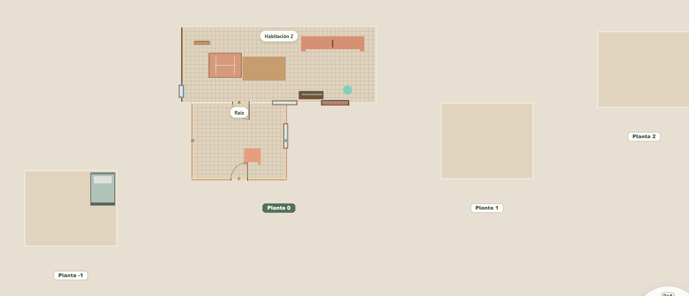
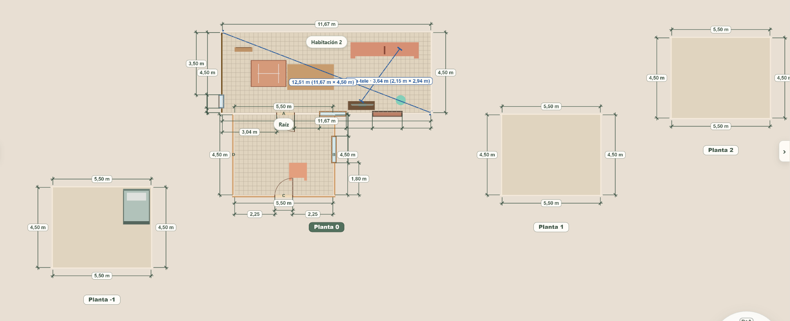

# F2 — Informe de progreso

## F2 · 01/03 — Guías inteligentes y magnetismo (#37, RB-045)

Rama: `feature/f2-01-guias-magnetismo`. Estado: **implementado, con E2E y validado visualmente por el propietario (15/11/2026); pendiente de PR a `main` y CI**.

### Decisiones del propietario (15/11/2026)

1. **Imán de paredes → unificado (1-A).** El contacto con la pared que ya existía (`softWallSnap`) obedece al interruptor de magnetismo y a Alt. Antes estaba siempre activo.
2. **Preferencias fuera del diseño (2-A).** Magnetismo y guías se guardan en `localStorage` (`room-builder:v0.2:editor-preferences`). No hay cambio de formato, versión ni migración, y no entran en el historial ni en el JSON/GLB.
3. **«Ajuste a 5 cm» configurable (3-B).** Reutiliza el campo ya persistido `gridSnap` (sin cambio de formato). Desactivado, los arrastres avanzan de 1 en 1 cm.

### Qué hace

- **Guías** (líneas y cotas) mientras se arrastra: bordes con bordes, centros con centros, centrado respecto al punto medio de una pared ortogonal cercana (≤ 1,5 m), huecos iguales entre dos vecinos y cotas en cm a los vecinos más próximos.
- **Magnetismo**: atrae a esas referencias dentro de 6 cm (en metros del mundo). Se calcula siempre desde la posición pedida por el puntero, nunca desde el resultado anterior: no hay saltos al salir de la tolerancia, al pulsar/soltar Alt ni al soltar el gesto.
- **Alt** suspende el magnetismo (incluido el imán de paredes) mientras está pulsada. Se lee con un listener de ventana (`src/state/dragModifiers.ts`).
- **Independencia**: ajuste a 5 cm, magnetismo y guías son tres interruptores separados (panel de cuadrículas) con indicador visible en la cabecera de la escena y texto `aria-live` para las guías activas.
- **Alcance de vista**: Plano, Isométrica y Libre. En Frontal y POV no hay guías ni imán de alineación.
- **Solapes permitidos (RB-041)**: no se añade ninguna restricción; las guías solo atraen.
- **Multiselección**: el arrastre del cuerpo del grupo usa la caja envolvente como referencia. El arrastre por flechas del grupo solo cambia al paso configurable (sin guías).

### Archivos

- Dominio puro: `src/domain/dragGuides.ts`.
- Estado: `src/state/actions/guideActions.ts`, `src/state/dragModifiers.ts`, `src/state/editorPreferences.ts`; cambios en `useRoomStore.ts`, `types.ts`, `furnitureActions.ts`, `historyActions.ts`, `furnitureWalls.ts`, `measurements.ts`.
- Escena/UI: `src/scene/DragGuidesOverlay.tsx`, `MultiFurnitureGizmo.tsx`, `FurnitureGizmos.tsx`, `src/components/editor/MovementStatus.tsx`, `GridVisibilitySection.tsx`, `App.tsx`, `RoomScene.tsx`.

### Límites conocidos

- Muebles girados: las guías usan la caja alineada con los ejes que envuelve al mueble (exacta a 0° y 90°; aproximada a otros ángulos). Paredes oblicuas no ofrecen guías.
- Las posiciones se guardan en cm enteros: dos bordes cuya diferencia no sea múltiplo de 1 cm quedan alineados con ≤ 5 mm de error.
- Solo cuentan muebles visibles que comparten altura con el objeto movido.
- La tolerancia es fija en metros (6 cm), no depende del zoom (coherencia entre vistas por diseño).
- Los arrastres por flecha aplican el imán solo en su eje libre.

### Pruebas

- Unitarias nuevas: `src/domain/dragGuides.test.ts` (tolerancia, ejes, giro, pared, huecos iguales, objetos ignorados, texto) y `src/state/dragGuides.test.ts` (puntero vs. teclado, Alt, interruptores, vista frontal, bloqueo, gesto único en el historial, imán de paredes, `gridSnap`, preferencias).
- Ejecutadas en local solo estas y las suites de `furnitureWalls`, `useRoomStore`, `multiSelection` y `measurements`: **68 correctas, 0 fallos**; `tsc -b` sin errores. La suite completa, el build y los E2E quedan para la CI de la PR hacia `main`.

### Pendiente

- E2E de Isométrica y de gestos táctiles (hoy cubiertos solo por pruebas unitarias).
- Actualizar `docs/DECISION_LOG.md` (RB-045) cuando el propietario valide la función.

### Correcciones tras la primera revisión visual (15/11/2026)

- **Mueble fijado a pared:** las guías se calculaban en la posición pedida por el puntero y no en la que el mueble ocupa tras el límite de la pared (cotas dibujadas lejos del objeto). Ahora los ejes bloqueados o impedidos por la pared conservan su coordenada actual; en paredes oblicuas no hay guías. Test añadido.
- **Interruptores:** etiqueta y descripción en dos líneas, interruptor de tamaño fijo, textos más cortos; el estado lo transmite el propio interruptor (`aria-checked`).
- **Cabecera de escena:** la medida de la habitación pasa a la lista de insignias, como 5.º elemento, con el formato `5.5 x 4.5 = 24.75 m²`.

### E2E (15/11/2026)

- Nuevo `tests/movement-guides.spec.ts` (6 pruebas, 1 `@smoke`): alinear dos muebles en Plano (borde atraído, guía visible y retirada al soltar), Alt sin salto, guías sin magnetismo, un gesto = un paso de historial, «Ajuste a 5 cm» independiente y sin «Cambios sin guardar», y formato de la medida de la habitación. La escala del arrastre se calibra en el propio navegador.
- `tests/checkpoint-v02.spec.ts` actualizado al nuevo texto de la medida (`4.2 x 3.6 = 15.12 m²`).
- Local (Windows): ambos specs pasan (7/7). En una tanda con `furniture-gestures` hubo 2 tiempos agotados de las pruebas nuevas y 1 de una prueba táctil ya existente; todas pasaron al repetirlas aisladas (carga de la máquina). Se subió el tiempo máximo del spec nuevo a 60 s.

### Nota de producto (sin implementar)

El propietario indica que «Mostrar detalles» (Plano detallado, #26) debería parecerse a un plano arquitectónico con cadenas de cotas exteriores e interiores (grosores de pared, huecos de puertas y ventanas, particiones). No forma parte de #37; encaja con #38 y requiere decisión antes de implementarse.

## F2 · 02/03 — Regla de medición completa y cotas guardables (#38, RB-046)

Rama: `feature/f2-02-regla-cotas`. Estado: **implementado (contornos rectangulares), con pruebas unitarias y E2E; revisado visualmente por captura del agente, sin validación humana; sin PR**.

### Decisiones del propietario (16/11/2026)

1. **Anclajes:** cotas absolutas **y** ancladas a muebles (esquinas, puntos medios, centro) y a esquinas de pared. Si el referente se mueve, la cota se recalcula sola.
2. **Referente borrado:** la cota se conserva **fija** en su última posición con una advertencia visible (`stale`) hasta que el usuario la acepte o edite. Nunca desaparece ni miente.
3. **Formato:** v13 solo cuando hay cotas (sin ellas sigue v12); ver [DATA_AND_FORMATS](../DATA_AND_FORMATS.md).

### Qué hace

- **Herramienta «Medir»** (botón en la barra del Plano, funciona con «Mostrar detalles» activado o no, sin cambiar de vista, cámara, selección ni historial): clic/toque en dos puntos o arrastrar. Muestra la distancia real y, si es oblicua, sus componentes (`5,00 m (4,00 m × 3,00 m)`).
- **Ayudas:** Libre / Horizontal / Vertical (los de la pantalla, aunque el Plano esté girado; Mayús fija horizontal) e **imán** opcional (14 px) a esquinas de pared y esquinas, puntos medios y centro de muebles. El imán de la regla es independiente del magnetismo de #37 (no comparten estado).
- **Medidas temporales:** se descartan con «Descartar» o Esc; Intro las guarda. Salir de Plano desactiva la herramienta.
- **Cotas guardadas** (parte del diseño, un paso de historial por alta/edición/ocultación/baja): lista «Cotas guardadas» en el panel izquierdo con ocultar, editar y eliminar; alta por coordenadas como vía de teclado.
- **Editar una cota** (revisado 16/11/2026 a petición del propietario): ya no se escriben coordenadas. «Editar» lleva al Plano y muestra los puntos A y B como asas que se **arrastran en la vista** (imán a esquinas y bordes que los **vuelve a anclar**, Mayús fija horizontal). El arrastre es una vista previa: al soltar se guarda en un único paso de historial; Esc lo cancela. Mover un punto a un lugar libre lo deja fijo; a una esquina de mueble/pared, anclado. El panel muestra a qué sigue cada punto, permite renombrar y ofrece ajuste fino con botones (1 cm; Mayús, 10 cm) como vía de teclado. Medir y editar son modos excluyentes. Corrige además el fallo de que una cota editada y guardada dejaba de seguir a su mueble.
- **Desplazar el Plano con la rueda:** mantener pulsada la rueda del ratón desplaza la vista desde cualquier punto (sobre muebles, con Medir activo…) sin seleccionar ni mover nada (`src/scene/PlanWheelPan.tsx`). Se dibujan en azul solo con «Mostrar detalles» y si no están ocultas; con advertencia roja si están obsoletas.
- **Persistencia:** se conservan al guardar, recargar y en el JSON; validación estricta al importar.
- **Accesibilidad:** botones y formularios operables con teclado y táctil (destinos de 44 px en móvil), lectura `aria-live` de la distancia, alertas para cotas obsoletas.

### Archivos

- Dominio puro: `src/domain/planMeasures.ts` (tipos, anclajes, recalculado, imán, proyección, validación, visibilidad).
- Estado: `src/state/actions/measureActions.ts`; cambios en `useRoomStore.ts` (recalculado en el mismo paso de historial), `types.ts`, `designActions.ts`, `historyActions.ts`.
- Formato: `designV1.ts`, `designMigrations.ts`, `designFile.ts`, `projectV2.ts` (solo tipo).
- Escena/UI: `src/scene/PlanMeasures.tsx`, `src/components/editor/MeasureControls.tsx`, `ViewControls.tsx`, `ObjectsPanel.tsx`, `App.tsx`, `RoomScene.tsx`, `styles.css`.

### Pruebas

- Unitarias nuevas: `src/domain/planMeasures.test.ts` (12) y `src/state/measures.test.ts` (12): diagonal 4×3 = 5 m, anclajes, recalculado, referente borrado, imán, proyección de ejes, contrato y rechazos, migración v12→v13, JSON, historial, sesión.
- E2E nuevos: `tests/plan-wheel-pan.spec.ts` (3, 1 `@smoke`: rueda sobre un mueble, con Medir y fuera de Plano) y `tests/plan-measures.spec.ts` (7, 3 `@smoke`; incluye arrastrar un punto, cancelar con Esc y anclar a un mueble): dos clics y distancia, Escape y salida de Plano, guardar dos cotas/editar/ocultar/eliminar/deshacer, recarga + JSON + validación, referente movido/borrado. El E2E detectó un fallo real del formulario (lectura de `currentTarget` diferida) ya corregido.
- Local: `tsc -b` limpio; unitarias de persistencia, diseño, store, historial y diagnóstico (110 correctas, 0 fallos) y los 5 E2E nuevos pasan. La suite completa, el build y el resto de E2E quedan para la CI.

### «Ampliación 09/11» de #38 — Plano detallado (16/11/2026)

Decisiones del propietario: las distancias de muebles se muestran **solo del mueble seleccionado**, y los huecos se acotan como **cadena por pared, por fuera**, como en un plano de arquitectura.

- **Categorías** (filtros secundarios de «Mostrar detalles», estado de sesión que no toca diseño, historial ni selección): *Paredes* (cota total de #26, sin recalcular por otra vía), *Huecos*, *Muebles* y *Notas* (cotas guardadas). Por defecto: Paredes, Huecos y Notas activas; Muebles apagada. En Plano normal no aparece ninguna superposición ni los filtros. Con «Paredes» apagado vuelven las etiquetas normales de pared.
- **Huecos:** por cada pared de habitación con puertas o ventanas, una cadena de tramos (pared hasta el hueco · ancho del hueco · resto hasta el extremo) con testigos, por fuera de la cota total. Se recalcula al mover o redimensionar un hueco; las ventanas despegadas no se acotan. Etiquetas que no caben se simplifican o se ocultan con el zoom (mecanismo de #26).
- **Muebles:** con el filtro activo, las distancias del mueble seleccionado a la cara interior de la pared más cercana en cada dirección (huella girada, solo paredes ortogonales). Se recalculan al moverlo.
- **Accesibilidad:** el resumen `aria-live` incluye las categorías activas.
- Código: `src/domain/planDimensionDetails.ts` (cálculo), `PlanDimensions.tsx` (nivel de cota), `PlanMeasures.tsx` (distancias de mueble), `ViewControls.tsx` (filtros), `RoomScene.tsx`.
- Pruebas: `planDimensionDetails.test.ts` (9 unitarias) y `tests/plan-details-categories.spec.ts` (4 E2E, 1 `@smoke`). `plan-dimensions.spec.ts` se ajustó a que el resumen ahora puede incluir huecos.

**Pendiente de esta ampliación:** capturas comparativas de Plano normal y detallado; cotas de puertas/ventanas en habitaciones sin cadena propia cuando una pared está oculta; cotas de escaleras (#64) y de plantas múltiples (#52); contornos irregulares (#35). El estilo de «plano arquitectónico completo» de la imagen de referencia (cadena exterior total + tramos interiores en el mismo trazo) se aproxima con los dos niveles actuales; cotas interiores de particiones no se incluyen.

### Girar el Plano en cuatro lados (16/11/2026)

Botones ↶ / ↷ en la barra del Plano con el indicador «Arriba: pared X»: cada pulsación gira la cámara un cuarto de vuelta (A, B, C, D arriba). Es solo cámara de sesión (`topOrientation`; acción `rotateTop`): no toca diseño, historial, selección ni cotas. El encuadre inicial se adapta al giro (el ancho de la habitación pasa a ser el alto de la pantalla). Medir (Horizontal/Vertical), el desplazamiento con la rueda y las flechas del botón de restablecer siguen la orientación de la pantalla. La barra del Plano pasa a una segunda fila cuando no cabe, en vez de salirse de la escena. Pruebas: `src/state/planRotation.test.ts` (3) y 2 E2E en `tests/plan-wheel-pan.spec.ts` (1 `@smoke`).

### Puertas como en un plano: giro elegible (16/11/2026)

A petición del propietario (decisiones: símbolo solo en el Plano; por defecto bisagra izquierda y hacia dentro):

- **Símbolo de plano:** la puerta se dibuja con hueco en la pared y jambas, la hoja abierta a 90° y el arco de giro (`PlanWallSymbol.tsx`, geometría pura en `src/domain/doorSwing.ts`). El modelo 3D sigue cerrado. Se ve en Plano normal y detallado.
- **Inspector de la puerta:** «Giro de la puerta en el Plano» con vista previa, **bisagra** (izquierda/derecha, mirando la pared desde dentro) y **se abre** (hacia dentro/fuera de la habitación). Funciona para la puerta principal, las adicionales y las de otras habitaciones. Una puerta bloqueada no cambia de giro.
- **Formato v14:** `DoorConfig.swing?: { hinge: 'left' | 'right'; side: 'inside' | 'outside' }`. Solo se escribe v14 cuando alguna puerta tiene giro elegido; las puertas sin giro se dibujan con el predeterminado y ningún diseño guardado cambia. Migración 13→14 = identidad; un diseño anterior a v14 con giros se rechaza; validación estricta al importar. Ver [DATA_AND_FORMATS](../DATA_AND_FORMATS.md).
- Pruebas: `src/domain/doorSwing.test.ts` (10: las 4 combinaciones, arco, contrato, historial, migración, JSON, bloqueo) y `tests/door-swing.spec.ts` (3 E2E, 1 `@smoke`).
- Límites: la puerta no se abre en 3D ni en la exportación GLB; el sentido «izquierda/derecha» es el de quien mira la pared desde el interior (la vista previa del inspector usa esa perspectiva).

### Capturas comparativas Plano normal / Plano detallado (16/11/2026)

Capturas aportadas por el propietario del mismo diseño (planta 0 con la habitación raíz y «Habitación 2», más plantas −1, 1 y 2), tomadas a mano en la web:

| Plano normal | Plano detallado |
|---|---|
|  |  |

- **Qué muestran:** sin «Mostrar detalles» no hay ninguna superposición técnica (solo puertas con su arco de giro, etiquetas de habitación y planta); con él aparecen las cotas totales de cada pared (también en las demás plantas), la cadena de huecos (p. ej. 2,25 · 1,00 · 2,25 m en la pared de la puerta) y las cotas guardadas en azul.
- **Defecto observado:** dos cotas guardadas con etiquetas cercanas se pisan (p. ej. «12,51 m (11,67 m × 4,50 m)» sobre «…-tele · 3,64 m»). Las etiquetas de las cotas guardadas no tienen aún evitación de solapes; las de pared sí se simplifican con el zoom.
- Son capturas manuales, no generadas por una prueba automática; sirven como evidencia visual, no como comparación pixel a pixel.

### Límites conocidos

- Mientras la herramienta está activa, arrastrar con el botón izquierdo mide; para desplazar, mantén la rueda del ratón (o desactiva la herramienta).
- Las cotas viven en el plano X/Z: no distinguen plantas; se dibujan a la altura de la planta enfocada.
- Sin E2E táctil ni de teclado del trazado (el alta por coordenadas es la vía de teclado).

### Nota de producto (sin implementar)

El propietario indica que «Mostrar detalles» debería parecerse a un plano arquitectónico con cadenas de cotas exteriores e interiores (grosores de pared, huecos, particiones). Es el objetivo de la parte pendiente de arriba.
